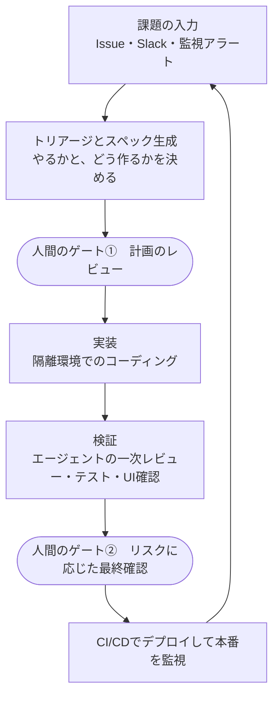
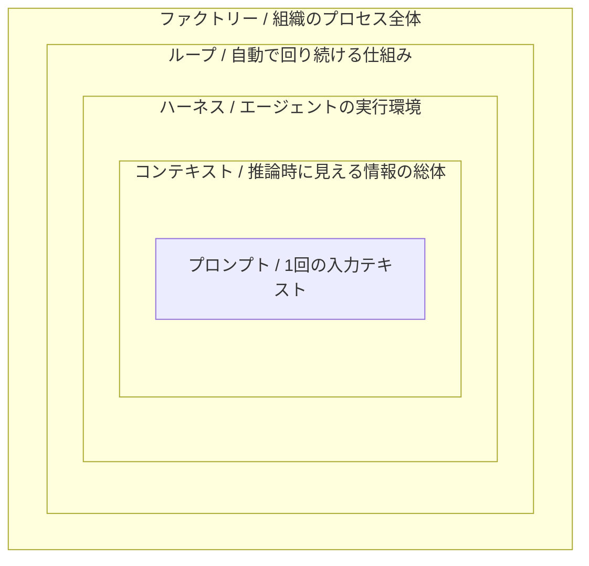

# Zenn問答とは

「Zenn問答」とは、開発していて「なんとなく使ってるけど、ちゃんと理解してるかな？」という技術について、改めて時間をとって深掘りしてみようという企画です🧘🧘🧘

# はじめに

ここ最近、いろんなところで「Software Factory」という単語を見かけるようになりました。

カンファレンスのセッションタイトルにも、企業のテックブログにも、タイムラインにも出てきます。ハーネスエンジニアリングだの、ループエンジニアリングだの、新興の言葉の類であることはわかりますが、たくさんあって大変ですね。

世の中の流れがあまりにも速いので、「一時的な流行でしょ」で片付けておきたい気持ちはありつつ、気づいたら周りが全員当たり前の知識として知っている状態になるのも怖いです。ということで今回はSoftware Factoryについて深掘りしてみます。

# Software Factoryは60年前からある言葉

いきなり衝撃的な事実ですが、以前からこの言葉自体はあったようです。

発想自体は1960年代の終わりに出てきました。ハードウェアの進歩にソフトウェア開発が追いつかない、いわゆる「ソフトウェア危機」の時代で、1968年のNATOソフトウェア工学会議では、ソフトウェアも工業製品のように、規格化された部品を組み合わせて作るべきではないか、という提案がありました。

そして、それを最初に組織として実装したのが日本です。1969年、日立製作所がソフトウェア開発専門の事業所を設置し、そのまま「ソフトウェア工場」と名付けました。初めてソフトウェア組織を「工場」と呼んだ事例とされていて、その後NEC、東芝、富士通も続いていきます。

工程の標準化、設計・テスト手法の統一、支援ツールの内製、部品の再利用、品質の数値管理の徹底が当時は栄華を極めていたようです。日本のファクトリー型はアメリカの職人芸型に比べて生産性58%以上、品質2倍以上という数字が出ていたそうです。ただし重要な但し書きもあって、**独創的なソフトウェアを作るにはアメリカ型のほうが向いている** という指摘です。

なんか今でもその名残が色濃く残っている気がしますねぇ・・・

その後も、この言葉は形を変えて何度か復活しています。

| 時期 | 何を工場化したか | 労働力 | 当時のボトルネック |
|---|---|---|---|
| 1969年〜 日本のソフトウェア工場 | 工程・品質管理・部品の再利用 | 人間 | 人間の書く速度と品質のばらつき |
| 2004年〜 MicrosoftのSoftware Factories | DSLとモデルからのコード生成 | 人間 + ジェネレーター | 定型コードを人間が書いていたこと |
| 2019年〜 国防総省のSoftware Factory | ビルド・セキュリティ・デリバリー | 人間 + CI/CD | リリースまでの承認と検証の遅さ |
| 2025年〜 AIエージェントのファクトリー | 開発ライフサイクル全体 | AIエージェント | 生成されたものを検証する速度 |

共通しているのは「個人技をやめてシステムにする」という方向性と、**毎回そのとき一番詰まっていた工程を自動化しようとしている** ことです。じゃあ今回詰まっているのはどこなのか、という話が、そのまま2026年のSoftware Factoryの定義につながります。

# 2026年のSoftware Factoryとは何なのか

一言でいうと、 **AIエージェントを労働者として、人間がプロセスを設計することで、ソフトウェアを継続的に生産し続ける開発システム** です。

イベントを起点に仕事が始まり、構造化されたワークフローに沿ってエージェントを動かす。この「イベント起点」が従来の開発との一番の違いです。

従来との差分については「Agentic AI in the Software Development Lifecycle」という論文から抜粋します。

https://arxiv.org/abs/2604.26275

| 工程 | 従来のSDLC | A-SDLC |
|---|---|---|
| 要件定義 | アナリストが仕様を書く | 意図を伝え、エージェントが草案を書く |
| 設計 | アーキテクトが図を起こす | エージェントが案を出し合って批評し、人間が選ぶ |
| 実装 | エンジニアがコードを書く | コーディングエージェントが計画を実行し、人間がレビューする |
| テスト | QAがテストを書いて回す | テストエージェントがスイートを生成する |
| デプロイ | 手動またはパイプラインで昇格 | CIエージェントがゲートし、人間が承認する |
| 保守 | オンコール、チケット、ホットフィックス | 監視エージェントがトリアージし、修復エージェントが直す |

影響の大きい操作には人間の承認を挟むことも前提に置かれています。工程をひとつの流れにすると、こんな形になります。

最後の監視が最初の入力に戻っていて、本番で出たエラーが次の課題として自動的に投入されることになり、継続的な仕組みとして回り続ける構造になっています。

そして、人間のゲートが2箇所しかないのも大きく変わったポイントだと思います。「全部の差分を読む」のではなく、「計画を承認する」と「リスクの高いものだけ最終確認する」に絞られています。

Software Factoryとは「エージェントの並列実行」のことではない、という点が大事なのかなと思っています。ターミナルを20個開いて順番に指示とレビューをするのは、単に人間の認知を20倍に酷使しているだけで、ボトルネックが人間である構造には変わりありません。人間が介在するプロセスを減らして価値を最大化しようというアイデアに聞こえました。

# ハーネス・ループ・ファクトリーの関係

ここで冒頭の「ハーネスエンジニアリング」「ループエンジニアリング」が回収できます。これらは競合する概念ではなく、内側から外側に向かって入れ子になっています。

| 層 | 設計する対象 | 代表的な成果物 |
|---|---|---|
| プロンプト | 1回の入力テキスト | 指示文、Few-shotの例 |
| コンテキスト | 推論時に見える情報の総体 | システムプロンプト、ツール定義、検索戦略 |
| ハーネス | エージェントの実行環境 | ツール群、サンドボックス、権限階層、メモリ方針 |
| ループ | 自律的に走り続ける仕組み | 定期実行、サブエージェント、状態ファイル |
| ファクトリー | 組織の開発プロセス全体 | 工程の定義、ゲートの位置、メトリクス |

ハーネスは「Agent = Model + Harness」と定式化されます。モデルそのもの以外の全部、つまりループを回す制御コード、ツール、権限管理、メモリ、コンテキスト管理、ガードレールの総体です。Claude CodeやCodex CLIがまさにこれで、裏側のモデルが同じでも使い心地がまったく違うのは、ハーネスが違うからですね。

プロンプトとハーネスの決定的な違いは、**強制力があるかどうか** だと思っています。プロンプトに書いた「必ずテストを書いてください」は無視されうるルールですが、CIでブロックするのは無視できないルールです。

その外側のループは、自分がエージェントに毎回プロンプトを打つのをやめて、**自分の代わりにプロンプトを打つ小さなシステムを設計する** ことを指します。

そしていちばん外側がファクトリーです。**単一エージェントの環境を整えるのがハーネス、それを自走させるのがループ、組織規模に束ねるのがファクトリー** というところでしょうか。

なお、ファクトリーを稼働させるループには2種類あるみたいです。
日々の課題を処理するインナーループと、ループそのものを改善するアウターループです。

# すごい事例

実際にSoftware Factoryの事例も海外を中心に聞くようになってきました。

## Stripeの「Minions」

まずはStripeの事例です。社内製のコーディングエージェント群を「Minions」と呼んでいます。

https://stripe.dev/blog/minions-stripes-one-shot-end-to-end-coding-agents

| 項目 | 数値 |
|---|---|
| minionが作ってマージされたPR | 週1,000本以上（2026年2月時点では1,300本以上） |
| そのPRに含まれる人間が書いたコード | 0行 |
| 人間のレビュー | 全件必須 |
| 使えるMCPツール | 400〜500個 |
| devboxの起動時間 | 10秒以内 |

> A typical minion run starts in a Slack message and ends in a pull request which passes CI and is ready for human review, with no interaction in between.

Slackで頼んで、戻ってきたらCIが通ったPRができている。途中のやりとりは一切ない。未来って感じがしますが、これくらいならなんか実現できる気はしますね。

この事例では、機構の作り込みも素晴らしい点が良かったのかなと思っています。

- devboxは事前に温めてあり10秒で立ち上がる。しかも本番リソースとインターネットからは隔離されている。
- 300万あるテストから関連するものだけを選んで実行する。CIを回すのは最大2回まで。それでも直らなければ人間に返す。
- グローバルなルールは最小限にして、ディレクトリやファイルパターンごとにルールを渡す。
- 決定論的にやれる判断は、LLMではなくコードでやる。リント、git操作、プッシュは全部こちら側。

2点目から4点目、こういう部分の整備が本当に難しい部分で、これがネックになっていることも多いのではないでしょうか。こういうプロセス整備の専門部隊みたいなのがいるんでしょうね・・・チーム開発の傍らで装着するにはやっぱりハードルはありそうです。

> If it's good for humans, it's good for LLMs, too.

人間のために整備してきたソース管理、開発環境、テスト、CIといった資産を、そのままエージェントにも使わせる、という発想です。そもそものパイプラインがよかったという話なのか・・・

## ほかの会社はどうなのか

似たような話は、2026年に入って一気に増えました。Cursorの社内ではマージされるPRの35%以上が自律エージェント発、Vercelは7月にクローズしたIssueの75%以上をファクトリー経由で処理、Uberは8月時点でPRの70%以上がローカルまたはクラウドのエージェント発だそうです。

なかでもUberは社内プラットフォームとしての作り込みが徹底していて、4,000万件規模のコンテキストグラフ、2,500個の管理されたスキル、1,000以上のツールを束ねるMCPゲートウェイ、事前起動済みのKubernetes Podといった構成になっています。CI修復、コードレビュー、バグ調査、オンコールのアラート対応と、ワークフローごとにエージェントが割り当てられているのが特徴です。

ここまでの大きな会社がこういうスピード感で変革をしているのを見ると、すごいなーって思いますね。

# いい話ばかりでもない

ここまで良い話ばかりでしたが、影の部分にも触れておきます。

製造業には「lights-out factory」という、人間がいないので照明を消したまま稼働する無人工場の概念があります。これをソフトウェアに当てはめて、ライトファクトリーとダークファクトリーという対比をしている記事があります。著者のAddy OsmaniさんはLighthouseやWorkboxで知られる人で、14年のGoogle勤務を経て、今はAnthropicでClaude Codeを作っています。

| 種類 | 定義 |
|---|---|
| ダークファクトリー | 誰も読んでいないコードが、機械の検証だけを根拠に本番へ出ていく状態 |
| ライトファクトリー | 同じパイプラインで、判断が残るように灯りを点けたままにした状態 |

https://addyo.substack.com/p/software-factories-light-and-dark

ダークファクトリーが生むのが「理解債務」です。存在するコードの量と、人間が理解しているコードの量の差が開いていくことを指します。技術的負債と似ていますが、こちらは「そもそも誰も中身を知らない」という点でより厄介です。

本番が落ちたときに誰も原因を追えなくなるなんてことも発生しそうですね。ここまで極端じゃなくても、理解債務は現場でも感じている方は多いのではないでしょうか。

数字の面でも、検証がボトルネックになっている傾向は見えています。

- Faros AIのテレメトリ分析では、AI導入後にコードレビューの時間が91%増加し、PRのサイズが154%増加したと報告されています。
- Pragmatic Engineerの2026年の調査では、AIが書いたコードのレビューに週11.4時間、自分でコードを書くのに週9.8時間と、時間配分が逆転しています。
- METRの2025年の調査では、経験豊富な開発者がAIを使ったとき実際には19%時間が長くかかっていたのに、本人たちは20%速くなったと感じていたという結果が出ています。

## 避けては通れないコスト面の話

前半で紹介したUberですが、2025年12月に約5,000人のエンジニアへClaude Codeを展開したところ、利用率が32%から84%に跳ね上がり、**2026年の年間AI予算を4ヶ月で使い切りました。** エンジニア1人あたり月500〜2,000ドル、2時間のセッションで1,200ドル溶かした役員もいたそうです。

なかなか厳しいのがCOOのコメントで、トークン消費の増加と、顧客に届く機能の増加の間に「まだ何のつながりもない」と言っています。同じ成果のまま使う量だけ増えるなら、それは効率が上がったのではなく、単にコストが増えただけです。正直、AIの登場によって我々の使用しているプロダクトが劇的に進化したみたいなことは今のところないですよね。

# そもそもFactoryは適切な用語なのか

ちなみに「工場」という比喩自体への反論もあります。工場は同じものを大量に作る場所ですが、ソフトウェア開発の価値の多くは「何を作るべきか」を決めるところにあるので、工場ではなくオーケストラと呼ぶべきだ、という主張です。譜面通りに弾けるところはエージェント、即興と解釈は人間、という整理ですね。

・・・となってくると改めてですが言われたことをきっちりこなすのが得意な日本の大規模で歴史のあるソフトウェア企業はAI時代は何か大きな変革が起きない限りはますます苦戦しそうですねぇ〜

# まとめ

Software Factoryについて深掘りしてみました。が、正直大した概念でもなく、理解しちゃえばよく分かる内容でした。

理解債務の話はいつまでもつきまとう気がします。正直、AIの登場で我々のシステムに対する深い理解は浅くなってきているのを感じます。自動化する範囲を広げれば、理解しない人がどんどん出てくる話なのかなと思います。

身近でも、何かの作業を自動化したらそれが壊れた時に結局その仕組みを作った人しか対応できないという経験はしたことがあると思います。それがAIに置き換わるとその人すらいない状況になります。

もちろん任せられる部分はAIに任せて楽するのがいいと思いますが、理解を放棄して楽しすぎると後で痛い目にあうような気がしますね。この考え自体も古臭いんですかねぇ〜まああと5年もすれば答え合わせができると思うので、自分はまだまだ理解についてはしっかりと頑張っていきたいと思います。

最後まで読んでいただき、ありがとうございました🙏
