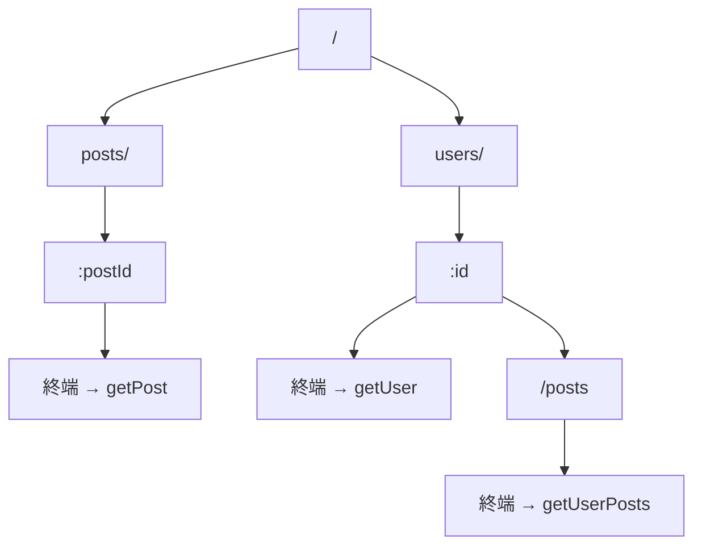

# Zenn問答とは

「Zenn問答」とは、開発していて「なんとなく使ってるけど、ちゃんと理解してるかな？」という技術について、改めて時間をとって深掘りしてみようという企画です🧘🧘🧘

# はじめに

最近、よく「Hono」という名前に出会います。が、正直APIサーバーを軽く立てられるやつくらいの理解しかありません。

Expressと何が違うか、今なんでこんなに流行っているのかを調べながら深掘りしてみます。

# そもそもHonoとは何なのか

公式のREADMEには、このように書かれています。

> Hono is a small, simple, and ultrafast web framework built on Web Standards.

https://github.com/honojs/hono

小さくて、シンプルで、すごく速い、そして **Web標準の上に作られた** Webフレームワークです。最初の3つは最近流行りのどのフレームワークも言いがちなので、Honoの特徴的な部分でいうと「Web標準の上に」の部分なのかなと思います。

Honoをコードで使おうとすると以下のようになります。

```ts
import { Hono } from 'hono'

const app = new Hono()

app.get('/hello', (c) => c.text('Hello Hono!'))

export default app
```

ほぼ説明不要な見た目です。そしてこの同じファイルが、Cloudflare WorkersでもDenoでもBunでも、そのまま動きます。

## 「Web標準の上に作られた」とはどういうことか

ここでいうWeb標準とは、ブラウザでおなじみの `Request`、`Response`、`Headers`、`URL`、`fetch` といったAPIのことです。

最近のサーバーサイドJavaScriptのランタイムは、「`Request` を受け取って `Response` を返す関数」をサーバーの基本形にしています。Honoの `app` はまさにこの関数を持ったオブジェクトで、外部ライブラリへの依存もゼロです。Web標準は各ランタイムの共通インターフェースで、Honoはそれだけで作られているから、どこでも動くということみたいです。


## Node.jsだけはアダプターが必要

Node.jsの `http` モジュールはWeb標準が整う前からある独自のAPIで、Expressはこの上に作られています。そのためNode.jsでHonoを動かすときは、`@hono/node-server` というアダプターがNode.jsのリクエストを `Request` に変換し、Honoが返した `Response` を書き戻します。

Expressが「Node.jsのAPIに乗ったフレームワーク」なのに対して、Honoは「Web標準のAPIに乗ったフレームワーク」ということみたいです、なるほど。

# Honoはなぜ生まれたのか

Honoの誕生については、作者のYusuke Wadaさん本人がCloudflareのブログに経緯を書いています。

https://blog.cloudflare.com/the-story-of-web-framework-hono-from-the-creator-of-hono/

始まりは2021年12月です。Cloudflare Workersでアプリケーションを作ろうとしたものの、フレームワークなしだとコードが冗長になり、かといってしっくりくるフレームワークも見つからなかったそうです。

素のWorkersで「`GET /books` にJSONを返し、それ以外は404」を書くとこうなります。

```ts
export default {
  fetch: (req: Request) => {
    const url = new URL(req.url)
    if (req.method === 'GET' && url.pathname === '/books') {
      return Response.json({ ok: true })
    }
    return Response.json({ ok: false }, { status: 404 })
  },
}
```

さらに `/authors/:name` のようなパスパラメータを扱おうとすると、`if` 文と正規表現が増えていきます。1つや2つならいいですが、まあこういうのはどんどん増えていってメンテナンスがつらくなるのはよく見る光景だと思います。

Honoならこう書くようです。

```ts
app.get('/books', (c) => c.json({ ok: true }))

app.get('/authors/:name', (c) => {
  const name = c.req.param('name')
  return c.json({ author: name })
})
```

当時もitty-router、Worktop、SunderといったWorkers向けの選択肢はありましたが、シンプルすぎたりAPIが好みではなかったりしたそうです。そこに「Trie木で高速なルーターを作ってみたい」という興味が重なって作り始めたのが、Honoの出発点です。

> While trying to create my applications, I ended up creating my framework for them.
> （アプリケーションを作ろうとしていたら、そのためのフレームワークを作っていた）

「典型的なヤクの毛刈り（yak shaving）」と書いていますが、その成果が今ではCloudflare自身のプロダクトの内部でも使われているというのが面白いところです。やはりこういう結果を意識しすぎない良いものを作る姿勢は大事だなと個人的には思いますね。

## エッジという制約が設計を決めた

当時のCloudflare WorkersはNode.jsではなく、V8のIsolateの上でWeb標準APIを提供するランタイムでした。Expressはそのままでは動かず、他にも強い制約がありました。Honoの特徴の多くは、この制約に向き合った結果です。

| Workersの制約 | 何が困るか | Honoの設計 |
|---|---|---|
| Node.jsのAPIがない | Node.js向けのフレームワークが動かない | Web標準APIだけで実装し、依存ゼロ |
| Workerのファイルサイズに上限がある | 重いライブラリを入れられない | コアを小さくし、機能はミドルウェアで足す |
| `eval` が使えない | 多くのテンプレートエンジンが動かない | サーバーサイドJSXを自前で実装 |
| CPU時間に上限がある（無料プランは1リクエスト10ms） | フレームワーク自体のオーバーヘッドが効いてくる | ルーター自体を徹底的に高速化 |

最小構成の `hono/tiny` ならHello Worldが12KBで、Expressの579KBとは桁が2つ違います。

その後v2でDenoとBunに対応し、今ではNode.jsやAWS Lambdaを含む主要な実行環境のほとんどをカバーしています。Web標準だけで作っていたからこそ、この拡張がスムーズにできたのでしょう。

## 名前の由来は「炎」

Honoは日本語の「 **炎** 」です。「炎」は英語で言えば「flare」に近く、最初に作ろうとしていたのが「Cloud **flare** Workers」向けのアプリケーションだった、というダブルミーニングになっています。作者のYusuke Wadaさんは日本の開発者で、現在はCloudflareでHonoの開発を続けています。

# Honoはなぜ速いのか

ここからは、Honoが「ultrafast」を名乗る根拠になっているルーターの話です。

## 従来のルーターは「先頭から順番に試す」

Expressのルーターは、登録されたルートを先頭から順に見ていき、それぞれの正規表現でリクエストパスにマッチするかを試します。ルートが100個あれば最悪100回の正規表現マッチが走り、ルートの数に比例して遅くなります。数ルートなら気にならない差ですが、ルートが増えて大規模になったり、エッジのようにCPU時間がシビアな環境だったりすると、ここが性能の足を引っ張ります。

## RegExpRouterは「全部を1つの正規表現にする」

HonoのデフォルトであるRegExpRouterは、 **登録されたすべてのルートを、1つの巨大な正規表現にまとめてしまう** という大胆な方法をとっています。

次の3つのルートを登録します。

```ts
import { RegExpRouter } from 'hono/router/reg-exp-router'

const router = new RegExpRouter<string>()
router.add('GET', '/users/:id', 'getUser')
router.add('GET', '/users/:id/posts', 'getUserPosts')
router.add('GET', '/posts/:postId', 'getPost')
```

内部で組み立てられる正規表現はこうなりました。

```
/^\/(?:posts\/([^/]+)$()|users\/([^/]+)(?:$()|\/posts$()))/
```

正規表現といいつつ、ルートをTrie木（共通の接頭辞をまとめた木構造）にしてから、それを正規表現の文字列に変換しています。



## 空のキャプチャグループで「どれにマッチしたか」を知る

1つの正規表現にまとめた結果、どのルートにマッチしたのかをどうやって判別するのかという疑問が出てきます。

その答えが、各ルートの末尾に付いている `$()` です。`()` は **何も捕まえない空のキャプチャグループ** で、マッチしたルートのものだけが空文字列 `''` になり、それ以外は `undefined` になります。正規表現を巧みに使っていますね〜

```ts
// '/users/42/posts' でマッチさせた結果
[
  '/users/42/posts', // 0: マッチした文字列全体
  undefined,         // 1: posts/([^/]+) の :postId
  undefined,         // 2: getPost の目印 $()
  '42',              // 3: users/([^/]+) の :id
  undefined,         // 4: getUser の目印 $()
  '',                // 5: getUserPosts の目印 $()  ← ここだけ空文字列
]
```

あとは `match.indexOf('', 1)` で最初に空文字列が出てくる位置を探せば、それがマッチしたルートの目印です。ルートが何個あっても正規表現のマッチは1回で済み、公式ドキュメントでも、ほとんどのケースでradix tree系のルーターより速いとされています。

## SmartRouterと5つのルーター

ただ、RegExpRouterは一部の複雑なルーティングパターンに対応できず、正規表現の組み立てにもコストがかかります。そこでHonoは、性質の違うルーターを5つ用意しています。

| ルーター | 方式 | 向いている場面 |
|---|---|---|
| SmartRouter | 複数のルーターから自動で選ぶ | デフォルトの司令塔 |
| RegExpRouter | 全ルートを1つの正規表現にまとめる | 起動後に何度もリクエストを捌く環境 |
| TrieRouter | Trie木をたどる | すべてのパターンに対応したいとき |
| LinearRouter | 登録は速く、マッチは線形 | リクエストごとにアプリが初期化される環境 |
| PatternRouter | 最小限の実装 | とにかくサイズを小さくしたいとき |

デフォルトの `new Hono()` は **SmartRouterにRegExpRouterとTrieRouterを持たせた構成** で、まずRegExpRouterを試し、対応できないパターンがあればTrieRouterに切り替えます。

# Honoの主な機能

## ミドルウェアとセキュリティ

ミドルウェアは `next()` の前後に処理を書くだけで作れて、外側から内側へ入り、ハンドラを通過したら内側から外側へ戻ってくる **オニオン構造** になっています。

セキュリティまわりの組み込みミドルウェアも揃っています。

| ミドルウェア | import | 何をしてくれるか |
|---|---|---|
| Secure Headers | `hono/secure-headers` | `X-Frame-Options` やCSPなど、セキュリティ系のレスポンスヘッダーをまとめて付与 |
| CORS | `hono/cors` | オリジン間リソース共有のヘッダーを制御 |
| CSRF Protection | `hono/csrf` | `Origin` ヘッダーなどを見てクロスサイトからのリクエストを弾く |
| Body Limit | `hono/body-limit` | リクエストボディのサイズに上限を設ける |
| JWT / Bearer Auth | `hono/jwt` / `hono/bearer-auth` | トークンによる認証 |

注意したいのは、Honoは「小さく始めて必要なものを足す」思想なので、 **何も足さなければ何も守られない** という点です。特にCORSは、`cors()` を引数なしで付けるとすべてのオリジン（`*`）を許可する設定になります。認証付きのAPIでは、必ず許可するオリジンを明示しておきましょう。

## RPCでフロントエンドと型を共有する

サーバー側のルート定義から型を取り出してクライアントに渡すだけで、APIのパス・引数・戻り値の型が補完されるようになります。

```ts
// server.ts
const routes = app.post('/posts', zValidator('json', schema), (c) => {
  const data = c.req.valid('json')
  return c.json({ message: `${data.id} is ${data.title}` })
})

export type AppType = typeof routes
```

```ts
// client.ts
import { hc } from 'hono/client'
import type { AppType } from './server'

const client = hc<AppType>('http://localhost:8787')

const res = await client.posts.$post({
  json: { id: 1, title: 'Hello' }, // 型が違えばコンパイルエラー
})

if (res.ok) {
  const data = await res.json() // { message: string } と推論される
}
```

OpenAPIのスキーマを書いてコード生成する、といった手順なしに、TypeScriptの型推論だけでサーバーとクライアントが繋がります。これは確かにサーバーもクライアントもTypeScriptの利点を大きく活かせるポイントですね。

# 競合フレームワーク

他の選択肢も整理しておきます。npmの月間ダウンロード数は2026年10月のもので、他のパッケージの依存として入ってくる分も含んだ参考値です。

| フレームワーク | 登場 | 土台 | 月間DL数 | 特徴 | クライアントとの型共有 |
|---|---|---|---|---|---|
| Express | 2010年 | Node.js | 約6億6,000万 | Node.jsの事実上の標準。困ったときの情報量が圧倒的 | なし |
| Hono | 2021年 | Web標準 | 約3億4,000万 | どこでも動く軽量フレームワーク | RPC（`hc`） |
| h3 | 2020年 | Web標準（v2） | 約1億6,000万 | NuxtやNitroの土台 | Nuxtの中なら `$fetch` |
| NestJS | 2017年 | Node.js | 約7,500万 | DIとデコレーターで構造を作る、Springに近い思想 | なし |
| Fastify | 2016年 | Node.js | 約7,100万 | Node.jsでの速さとJSON Schemaによるバリデーション | なし |
| Koa | 2013年 | Node.js | 約3,400万 | Expressのチームが作ったasync/awaitベースの後継 | なし |
| Elysia | 2022年 | Bun中心 | 約700万 | Bunでの性能を突き詰めた型安全フレームワーク | Eden Treaty |
| itty-router | 2020年 | Web標準 | 約140万 | 最小限の超軽量ルーター | なし |

用途別に整理すると、次のようになるでしょう。

| こんなとき | 候補 |
|---|---|
| エッジやサーバーレスで動かしたい、ランタイムを固定したくない | Hono |
| 既存のExpress資産や社内のノウハウがある | Express |
| Node.jsで高いスループットを出したい | Fastify |
| 大人数で大規模なAPIを作りたい | NestJS |
| Nuxtを使っている | h3（Nitro） |
| Bunで性能を突き詰めたい | Elysia |
| Workersで数ルートだけ捌きたい | itty-router |

# なぜ今Honoが流行っているのか

冒頭の「最近よく見る」が気のせいではないのか、npmの月間ダウンロード数で確認してみましょう。

| 月 | 月間ダウンロード数 |
|---|---|
| 2025年4月 | 約340万 |
| 2025年10月 | 約1,100万 |
| 2026年4月 | 約1億5,000万 |
| 2026年10月 | 約3億4,000万 |

1年半で約100倍です。背景には、いくつかの流れが重なっているように見えます。

## ランタイムが増え、Web標準が共通語になった

BunやDenoの台頭、サーバーレス・エッジ環境の普及で、JavaScriptを動かす場所は一気に増えました。動かす場所が増えるほど、「どこでも同じコードが動く」ことの価値は上がります。Honoは2021年の時点で「Web標準だけで作る」という選択をしていたので、世の中のニーズ的にも合っていたのでしょう。

## TypeScriptの型でフロントとバックをつなぐ流れ

フロントエンドもバックエンドもTypeScriptで書き、その間を型でつなぐスタイルが広がっています。コード生成なしでこれを実現できるHonoのRPCは、この流れにうまく乗っています。

## AIとMCPの時代にぴったりハマった

あとはAI関連の需要だと思います。LLMを扱うSDKの多くはストリーミングの結果をWeb標準の `Response` で返すので、Honoならそれをそのまま返せます。さらに、MCP（Model Context Protocol）の公式TypeScript SDKもHonoを使っています。

SDKの本体はWeb標準で作られていて、Node.jsで動かすときの変換役として `@hono/node-server` を使っています。前半で見た「Node.jsだけはアダプターが必要」という構図が、そのまま採用されているわけです。

SDKは2025年12月のv1.25.0からHonoを一緒にインストールするようになり、週に4,000万回以上ダウンロードされています。ダウンロード数が急増した時期とも重なっていますね。数字のすべてが「Honoを選んで使っている人」ではない点は割り引いて見る必要がありますが、AIエコシステムの基盤ライブラリが橋渡し役としてHonoを選んでいるのは、Web標準に寄せた設計が評価されている証拠と言えそうです。

# まとめ

Honoについて調べてみました。

APIサーバーたてるのに便利なやつくらいの認識でしたが、出発点は「Cloudflare Workersで使えるちょうどいいフレームワークがなかった」というかなり個人的な動機だったが、今やここまで広まっているのは興味深い話だなと思いました。
Node.js標準ではなくweb標準の設計思想で、ランタイムが多様化している今勢いがあるというのもよくわかりました。

まあ、2-3年後にはまた新たなフレームワークが最新と言われているような気がしますが、どうなんでしょうね。サーバーサイドTypeScriptも大規模プロダクトでも一般的になっていくのでしょうか・・・

最後まで読んでいただき、ありがとうございました🙏
