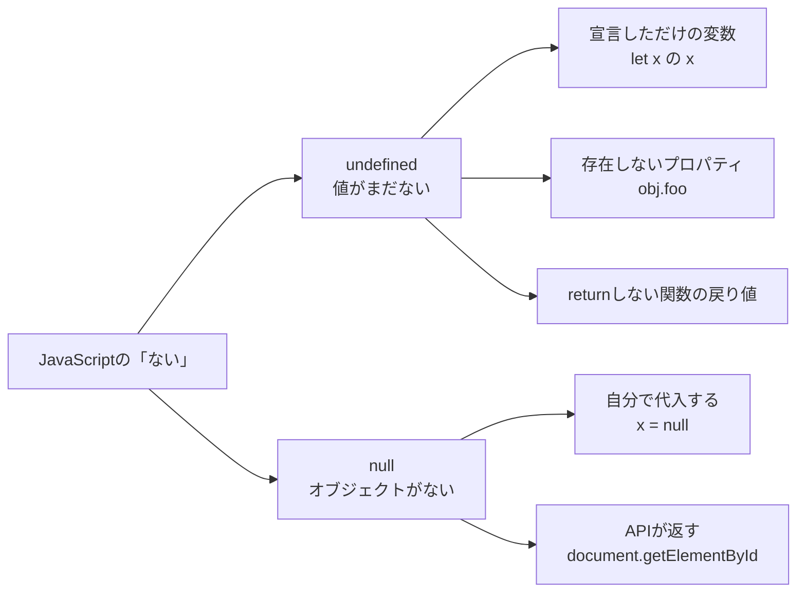

# はじめに

nullに対してずっとなんとなく嫌悪感を持ってきましたが、なぜ嫌いなのかをきちんと説明できない気がしたので、今回は腰を据えて考えてみました。

お気持ちとしては、次のようにnullが業務的な意味を持っているコードに対して「わかりづらいな」という感覚です。

```java
class Contract {
    // 契約開始日
    private LocalDate startDate;
    // 契約終了日
    private LocalDate endDate;

    // 契約が引数の日付で有効か否かを返却する
    boolean isActiveOn(LocalDate day) {
        if (day.isBefore(startDate)) {
            return false;
        }
        if (endDate == null) {
            // endDateがnullなら無期限
            return true;
        }
        return isEqualOrBefore(day, endDate);
    }

    // dayがlimitと同じ日か、それより前ならtrue
    private static boolean isEqualOrBefore(LocalDate day, LocalDate limit) {
        return !day.isAfter(limit);
    }
}
```

もちろんコメントを読めば意図は分かりますが、逆にいえばコメントを読まないと自信が持てません。
コメントがあるならまだいい方で、`endDate`フィールドのjavadocにだけ書いてあったり、最悪どこにも書いていなかったりします。

このような意味を持ったnullは、いろいろなコードで目にしてきたのかなと思います。idがnullなら新規登録、検索結果がnullなら0件、などなど。これくらい直感的なものならまだいいですが、直感に反した意味をnullが持っているケースにも、一度と言わず何度も遭遇してきたのではないでしょうか。つらいですね〜。

# nullとは

nullが嫌いだというなら、まずはnullのことを知らないといけません。

## nullの語源

nullの語源は、ラテン語の **nullus** です。否定の **ne** と、「ひとつ」を表す **unus** から派生した **ullus** （なにかひとつ）がくっついた言葉で、直訳すると「ひとつもない」という意味になります。
概ねイメージ通りじゃないでしょうか。

英語では、法律用語の「null and void（無効）」のように、「無効」「存在しない」という意味で使われてきました。数学でも、要素をひとつも持たない集合を「null set（空集合）」と呼びます。

ちなみにドイツ語では、今でも「null」は数字の「ゼロ」を意味します。日本でnullを「ヌル」と読むことが多いのはドイツ語読みから来ているという説があり、英語圏では「ナル」と発音されるのが一般的なようです。

## 10億ドルの過ち

nullの話をするなら、null参照を生み出したTony Hoareの講演が有名みたいです。Hoareはクイックソートの考案者としても知られています。すごい。

Hoareは1965年、ALGOL Wという言語を設計する中で **null参照** を導入しました。そして2009年のQCon Londonで、そのことを「10億ドルの過ち」と呼んで振り返る講演をしています。

https://www.infoq.com/presentations/Null-References-The-Billion-Dollar-Mistake-Tony-Hoare/

> I call it my billion-dollar mistake.

講演の概要によると、当時の目標は「参照の使い方をすべて安全にして、そのチェックをコンパイラに自動でやらせること」でした。それなのにnull参照を入れてしまったのは、実装がとても簡単でその誘惑に勝てなかったからだそうです。その結果が数え切れないエラーや脆弱性、システムのクラッシュで、40年で10億ドルくらいの損害を出してきたのではないかと語っています。

Hoareが作ったnullの意味は「この参照はどこも指していない」ということです。nullはもともと、参照という仕組みの都合から生まれた、かなり技術的な概念だったようです。この考え方はその後、C言語の`NULL`やJavaの`null`など、多くの言語に広がっていきます。

## いろいろな言語のnull

ここからは、いろいろな言語で「ない」がどう表されてきたのかを簡単に見ていきます。先に全体像を表にしておきます。

| できごと | 年代 | 意味 |
|---|---|---|
| ALGOL W・C・Java の null | 1965年〜 | 参照がどこも指していない |
| SQL の NULL | 1970年代〜 | 値が欠けている・不明 |
| Python の None・Ruby の nil | 1990年代 | 「ない」を表す実在のオブジェクト |
| JavaScript の undefined | 1995年 | 値がまだない（未初期化・プロパティがない） |
| JavaScript の null | 1995年 | オブジェクトがない（Java由来） |
| Go の nil | 2009年 | ポインタやスライスなどのゼロ値 |

### C言語の`NULL`

C言語では、null参照を表すマクロとして`NULL`が使われてきました。中身は`0`や`((void*)0)`で、これを参照すると未定義動作になります。整数の`0`と紛らわしいので、C++11やC23では`nullptr`というキーワードも導入されています。

マシン語になると、NULLはただの「0番地」です。OSは0番地付近をメモリに割り当てないので、たいていはセグフォで落ちます。
ただ、未定義動作なので落ちる保証はなく、コンパイラが「参照したのだからNULLではない」と判断してNULLチェックを消してしまい、Linuxカーネルの脆弱性（CVE-2009-1897）につながった例もあるようです。

### Javaの`null`

Javaでは、すべての参照型の変数に`null`を入れられます。nullが入った変数のメソッドを呼ぶと、おなじみの`NullPointerException`が発生します。

初学者が勘違いしやすいのが、Javaの`null`は **オブジェクトではない** という点です。`String s = null;`と書いても、`s`に「空っぽのString」が入っているわけではなく、`s`という参照がどこも指していない状態になるだけです。

Javaのバイトコードには`aconst_null`という「nullを積む」専用の命令があり、JVMの仕様ではnullを具体的にどんな値で表すかすら決められていません。
代表的な実装であるHotSpotではnullは0番地として扱われていて、nullの参照を読もうとしたときにOSが出すメモリアクセス違反をNPEに変換する仕組み（暗黙のnullチェック）も使われています。C言語と同じ「0番地付近はOSが割り当てない」という前提を、NPEの判定に利用しているようです。

### DBの`NULL`

DBの世界のNULLは、プログラミング言語のnullとは別の流れで生まれています。リレーショナルモデルの生みの親であるE. F. Coddが、1970年代に欠けているデータを表す方法としてNULLを持ち込み、NULLとの比較を「真・偽・不明」の3値論理で扱う考え方を示しました。こちらのNULLが表しているのは、参照がないことではなく **値が欠けていること** です。この概念は直感的なのではないでしょうか。

3値論理についてはミックさんの記事がわかりやすいので貼っておきます。
https://mickindex.sakura.ne.jp/database/db_3vl.html

### PythonとRubyの`None`・`nil`

Pythonの`None`とRubyの`nil`は、Javaの`null`とはまったく違う概念です。

Pythonの`None`はNoneTypeのたった1つのオブジェクトで、Rubyの`nil`もNilClassのオブジェクトです。つまりJavaのnullが「指す先がない参照」なのに対して、こちらは「ない」を表すオブジェクトが **実在していて、それを指している** わけです。そもそもPythonやRubyには、どこも指していない参照というものがありません。

### JavaScriptの`null`と`undefined`

JavaScriptはさらにややこしく、「ない」を表す値が`null`と`undefined`の2つあります。`undefined`は初期化されていない変数や存在しないプロパティの値、`null`は「オブジェクトがない」ことを表す値で、Javaの`null`を模して入れたものだそうです。

それぞれがどんな場面で出てくるかを図にすると、こんな感じです。



ざっくりいうと、`undefined`は言語が勝手に入れてくる「ない」、`null`は人間やAPIが意図して置く「ない」、と捉えると分かりやすいかもしれません。

この似ているけど振る舞いが違う2つの値が、歴史を通じてずっとプログラマーを混乱させてきたとも言われています。たしかにこれはややこしい・・・

### Goの`nil`

Goの`nil`は、ポインタ・スライス・マップ・チャネル・関数・インターフェースのゼロ値です。nilのスライスにそのまま`append`できるなど、「ない」を「空」として扱いやすい作りになっています。

# nullの2つの使われ方

nullについて少し理解したところで、今度は現場でのnullの使われ方を整理してみます。
考えてみたところ、対策の異なる2種類のnullがあるんじゃないかなという結論に自分の中で至りました。

- ① 「ない」を表しているnull
- ② 「ない」以外の意味を表しているnull

先に結論をいうと、どちらも型で表現してあげればいいと思っています。①は値を取り出す必要がある場合に「ないかもしれない」ことを型で示し、②はnullに込めていた意味そのものを型にする、という違いです。

ただ、自分が特に嫌いなのは②のほうです。まずは①の話を片付けてから、本題の②にいきましょう。

# ①「ない」を表しているnull

こちらについては正しい用法でnullを使っているケースです。

## どんなnullが①なのか

①は、「ない」こと自体がそのまま意味になっているnullです。たとえば次のようなものです。

- ミドルネームのない人のミドルネーム
- 任意入力の備考欄が空のまま
- IDで検索したけれど、該当するデータが見つからなかったときの結果

## ①で起きる問題はNPEくらい

①のnullで起きるのは、Hoareが10億ドルの過ちと呼んだ問題、Javaでいう`NullPointerException`（NPE）です。nullになりうるかどうかを型で区別できなかったころは、うっかりnullチェックを忘れて落ちるのはよくある話で、これは普通に大きな問題でした。

ただ、今はそこまで深刻な話ではなくなってきたと思っています。Kotlin、Rust、TypeScriptのように、nullになりうるかどうかを型で区別できる言語が増えたからです。

それに、 **NPEは落ちてくれる** という点も救いです。落ちるバグは見つかりやすいです。

## Option型で「ないかもしれない」を型にする

「ないかもしれない」ことを型で表す仕組みは、多くの言語が持っています。ここではRustを例にとってみます。

```rust
pub struct Person {
    first_name: String,
    middle_name: Option<String>, // ミドルネームはない人もいる
    last_name: String,
}

impl Person {
    pub fn full_name(&self) -> String {
        match &self.middle_name {
            Some(middle) => format!("{} {} {}", self.first_name, middle, self.last_name),
            None => format!("{} {}", self.first_name, self.last_name),
        }
    }
}
```

`Option<String>`は「`Some(値)`か`None`のどちらか」を表す型です。中身の`String`を使うには`match`などで取り出す必要があり、`None`の場合を書き忘れるとコンパイルエラーになります。ないかもしれない値をうっかり触って落ちる、ということが起きない仕組みです。

他の言語も、書き方は違えどだいたい同じ考え方です。

| 言語 | ないかもしれない値 | よく使う書き方 |
|---|---|---|
| Rust | `Option<T>` | `match`、`if let`、`unwrap_or` |
| Kotlin | `T?` | `?.`、`?:`（エルビス演算子） |
| Swift | `T?` | `if let`、`??` |
| TypeScript | `null`や`undefined`を含むユニオン型（`strictNullChecks`） | `?.`、`??` |
| Java | `Optional<T>` | `map`、`orElse`、`orElseThrow` |

※ Javaはすべての参照型にnullが入りうるので、`Optional`を使うだけでは強制力がありません（`Optional`型の変数にすらnullを代入できます）。強制したい場合は、JSpecifyの`@NullMarked`で「アノテーションのない型はnullにならない」と宣言し、NullAwayなどの静的解析ツールで違反をコンパイルエラーにする方法があります。

## そもそも取得しなくていいケースも多いはずなのでそこは改善してほしい

Option型を使って返却してもいいのですが、そもそもインターフェースを用意する必要がないケースも実は相当数あるかなと感じています。ミドルネームの例で説明します。

上の例のように呼び出す側が使うのは`full_name()`だけです。`middle_name()`は用意せず、呼び出す側はミドルネームがあるかないかを気にする必要がありません。「ないかもしれない」という事情はこの型の中に閉じ込められていて、扱いを考えるのはこの型を書く人だけで済みます。

逆に`middle_name()`を公開すると、呼び出す側のあちこちで「ない場合」の処理が必要になります。Javaのようにnullを返す言語なら、nullチェックを忘れて`"田中 null 太郎"`のように表示してしまう危険性もでてきます。そもそもミドルネームだけ必要になるケースって原則ないから作らないのが賢明かなと思います。

# ②「ない」以外の意味を表しているnull

ようやく本題です。こちらが、よくない用法でnullを使っているケースです。

## 本当に嫌なのは、nullがいろいろな意味を持つこと

Hoareの講演は2009年でしたが、多くの業務がソフトウェアに置き換わった今は、むしろこちらの②の方が大きな問題になっていると思います。こちらだけでも10億ドル以上の損失を生んでいる気もします。（とはいえ、nullのおかげでソフトウェアの裾野が広がった、と捉えることもできるかもしれません。）

Hoareのnullは「参照がない」という意味しか持っていませんでした。ところが実際はいろいろな意味を持っているnullがコードの中に出てきます。

コードに書かれているのは`null`だけなので、どの意味なのかはコメントやドキュメントが残っていないと書いた人の頭の中にしかありません。しかも厄介なのは、そのnullにチェックが必要かどうかも分からないことです。また、意味を取り違えて誤った実装をしてしまうと例外は飛ばず、ただただわかりづらいバグとなってしまいます。

たくさんの有識者たちが、バグの混入を頑張って食い止めていることかと思います。お疲れ様です。

## 意味を持つnullはモデルで表現すべき内容

大前提、自分はソフトウェアを作るときに **世の中を抽象化してモデル化すること** が原則としてあるべきだと考えています。
nullで表現される「まだ保存していないユーザー」「終わりの決まっていない契約」「まだ回答していない会員」は、どれも現実の世界にちゃんと存在する概念で、型で表現すべき内容ではないかと思います。それをnullで表すのは、モデル化を諦めて甘えた結果なのではないでしょうか。

端的に言うとモデル化をサボってnullをつけているケースが多いんじゃないのということが言いたいです。

# ②のnullには名前をつける

ここからは対策です。

Option型にしても、`None`が教えてくれるのは「ない」ということだけで、なぜないのかは相変わらず分からないので対策になりません。答えはシンプルで、 **nullに込めていた意味に名前をつけて、型にする** ことです。

## 意味ごとに型を分ける

### idがnull → 保存前と保存後で型を分ける

```java
// 保存前のユーザー（idを持たない）
record UserDraft(String name, String email) {}

// 保存済みのユーザー（idを必ず持つ）
record User(UserId id, String name, String email) {}

interface UserRepository {
    User register(UserDraft draft);
    User update(User user);
}
```

`if (id == null)`のような分岐が消えて、保存前か保存後かは型そのものが表すようになりました。ちなみにSpring Data JPAも、内部ではidがnullかどうかで新規かを判定しています。JPAのエンティティはidがnullになりうる作りなので、ドメインの型とは分けておくか、せめて`Persistable`で新規かどうかを明示しておくとよいでしょう。

### 終了日がnull → 「無期限」という型を作る

冒頭の`Contract`を書き換えると、こうなります。

```java
sealed interface ContractEnd permits FixedEnd, Indefinite {}
record FixedEnd(LocalDate date) implements ContractEnd {}
record Indefinite() implements ContractEnd {}

record Contract(LocalDate start, ContractEnd end) {
    boolean isActiveOn(LocalDate day) {
        if (day.isBefore(start)) {
            return false;
        }
        return switch (end) {
            case FixedEnd(LocalDate date) -> isEqualOrBefore(day, date);
            case Indefinite() -> true;
        };
    }

    private static boolean isEqualOrBefore(LocalDate day, LocalDate limit) {
        return !day.isAfter(limit);
    }
}
```

「無期限」がコードの中に名前を持って登場しました。期限付き契約と無期限契約で契約そのもののふるまいが変わるなら契約型をsealed interfaceにするのも選択肢のひとつです。

## 他の言語でも考え方は同じ

Rustならenum、Kotlinならsealed class、TypeScriptなら直和型と、道具は違っても「意味ごとに型を分ける」という考え方は共通です。

```rust
enum ContractEnd {
    Fixed(NaiveDate),
    Indefinite,
}
```

```ts
type ContractEnd =
  | { type: 'fixed'; date: string }
  | { type: 'indefinite' }
```

## Java 8で開発している場合は？

ちなみに、sealed interfaceもrecordもswitchのパターンマッチングもないJava 8ではどうすればいいのでしょうか？

仕方ないので、種類をenumのフィールドで持たせてあげて、nullableのフィールドはクラスに隠蔽するのがいいのかなと思います。

```java
public final class ContractEnd {
    public enum Type { FIXED, INDEFINITE }

    private final Type type;
    private final LocalDate date; // FIXEDのときだけ値が入る

    private ContractEnd(Type type, LocalDate date) {
        this.type = type;
        this.date = date;
    }

    public static ContractEnd until(LocalDate date) {
        return new ContractEnd(Type.FIXED, Objects.requireNonNull(date));
    }

    public static ContractEnd indefinite() {
        return new ContractEnd(Type.INDEFINITE, null);
    }

    public boolean includes(LocalDate day) {
        switch (type) {
            case FIXED:
                return isEqualOrBefore(day, date);
            case INDEFINITE:
                return true;
            default:
                throw new IllegalStateException("未対応の種類です: " + type);
        }
    }

    private static boolean isEqualOrBefore(LocalDate day, LocalDate limit) {
        return !day.isAfter(limit);
    }
}
```

「無期限」が`INDEFINITE`という名前でコードに登場し、種類ごとの処理もswitchで書けるようになりました。`INDEFINITE`のとき`date`はnullのままですが、コンストラクタをprivateにしてファクトリメソッドからしか作れないようにしておけば、「FIXEDなのに日付がない」といったおかしな組み合わせは生まれません。

# まとめ

ぼんやりと抱えていた「nullが嫌い」を深掘りしてみました。

自分が嫌いだったのは、nullそのものではなく、深く考えずにnullでとりあえず済ませてしまうことでした。これからはnullを書きたくなったら、「このnullを一言でいうと何だろう？」と5秒くらい考える時間を置くといいかもしれません。何か意味を持つなら本当は名前をつけてあげるべき概念なんじゃないかなと思います。

結局対策はきちんと型宣言しようねという話に帰着しちゃったのですが、既存コードとか、納期とか、社内謎フレームワークとか色々制約がある中なので完全な理想は難しいにせよ、できるところから対応していけば人間もAIも読みやすいコードになっていくんじゃないかなと思います。

最後まで読んでいただき、ありがとうございました🙏
